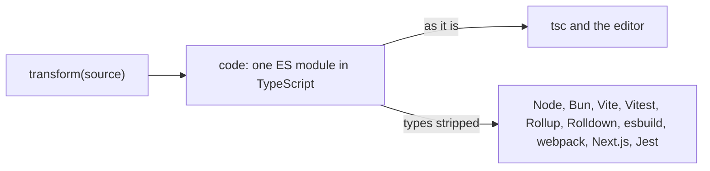

# content-mapper-starter

A starter kit for [TypeScript 7.1 content mappers](https://github.com/microsoft/typescript-go/pull/4712). You write one function that turns a file into TypeScript. That one piece of code types the import in tsc and the editor, and it is what runs in Node, Bun, Vite, Vitest, Rollup, Rolldown, esbuild, webpack, Next.js and Jest.

```ts
// src/mapper.ts
export default defineMapper({
  name: "ini",
  extensions: [".ini"],
  transform(source) {
    const data = parse(source);
    return { code: `export default ${JSON.stringify(data)} as const;` };
  },
});
```

```ts
import settings from "./settings.ini";

settings.server.port;
//              ^? (property) port: 8080
```

## How it works

A content mapper tells tsc what a file it doesn't understand means as a module. tsc only type-checks that module; it never emits JavaScript for it, so every runtime and bundler needs a plugin of its own to load the file.

This kit's plugins all call the same `transform`. tsc reads the code it returns as it is. Every other host strips the types, with the runtime's own type stripper (Node's or Bun's), and runs what is left. The type and the value come from one text, so they can't disagree.



## Make your own

1. Click **Use this template** on GitHub, or copy this repository.
2. Replace `my-content-mapper` everywhere with your package's name.
3. Edit [`src/mapper.ts`](./src/mapper.ts): its `name`, its `extensions` and its `transform`. Nothing under `src/kit/` needs to change.
4. Swap the example for your format: put a file of your format in place of [`example/src/settings.ini`](./example/src/settings.ini) (and fix the imports that name it), the value it should become in [`example/expected.json`](./example/expected.json), its exact type in [`example/src/main.ts`](./example/src/main.ts), and a broken file in [`example/broken/`](./example/broken).
5. Run the tests, which run the example through every host:

   ```sh
   npm install
   npm install --prefix example
   npm test
   ```

6. `npm publish`.

## Writing `transform`

`transform(source, path)` returns `{ code, diagnostics }`.

- **`code`** is one ES module, written in TypeScript. Put in it both the value and the type tsc should see, with `as const`, annotations, `satisfies` or `import type`. Imports in it resolve from the file's own location.
- **Only TypeScript whose types can be erased.** No `enum`, `namespace` or constructor parameter properties: Node's type stripping, which runs the code, doesn't accept them. The editor flags it if the code has one.
- **`diagnostics`** are `{ message, start, length }`, with `start` and `length` as string indices into `source`. tsc and the editor show them in the file, and every runtime and bundler fails with the file, line and column.
- **It may be `async`.** Node's and Bun's preload and Jest load modules synchronously, so they wait for it on a worker thread.
- **A type error in `code` is a type error in tsc.** It is reported at the file, with a note that it is in generated code.

## Setup, for the people who use your mapper

This is what your README tells them, with your package's name and extensions in place of the example's.

Every project registers the mapper in its `tsconfig.json`, and runs tsc with `--runExternalCode`, which content mappers require:

```jsonc
{
  "compilerOptions": { /* … */ },
  "contentMappers": [{ "package": "my-content-mapper", "extensions": [".ini"] }]
}
```

In VS Code or Cursor, install the TypeScript 7 extension (`TypeScriptTeam.native-preview`), point it at the project's TypeScript, whose version has content mappers, and trust the workspace, the only kind in which it runs them:

```jsonc
// .vscode/settings.json
{
  "js/ts.experimental.useTsgo": true,
  "js/ts.tsdk.path": "./node_modules/typescript"
}
```

Then each runtime or bundler takes its own entry:

```sh
# Node, Bun and nub, without a bundler
node --import my-content-mapper/register main.ts
bun --preload my-content-mapper/register main.ts      # or preload in bunfig.toml
nub --import my-content-mapper/register main.ts       # or preload in nub.jsonc
```

```ts
// vite.config.ts: Vite and Vitest. The same plugin goes in Rollup's and Rolldown's plugins.
import contentMapper from "my-content-mapper/vite";

export default { plugins: [contentMapper()] };
```

```ts
// esbuild. Bun.build takes the same plugin.
import { build } from "esbuild";
import contentMapper from "my-content-mapper/esbuild";

await build({ entryPoints: ["src/main.ts"], bundle: true, plugins: [contentMapper()] });
```

```js
// webpack.config.js
export default {
  module: { rules: [{ test: /\.ini$/, use: "my-content-mapper/webpack" }] },
};
```

```ts
// next.config.ts: Turbopack and webpack, server and browser
import type { NextConfig } from "next";
import withMapper from "my-content-mapper/next";

const nextConfig: NextConfig = {};

export default withMapper(nextConfig);
```

`next build` runs tsc without `--runExternalCode`, so `withMapper` turns that check off and runs the same one with the flag.

```jsonc
// jest.config.json
{ "transform": { "\\.ini$": "my-content-mapper/jest" } }
```

## Why one entry per host

Each host takes a different kind of thing: Vite a plugin object, webpack a loader's module path, Next.js a function that wraps its config, Jest a transformer's module path, Node a module to preload. So the package has one entry for each, each a few lines over the same `transform`. The preload is an entry of its own so a browser bundle never loads Node's loader hooks.

## What's here

| Path | What it is |
| --- | --- |
| [`src/mapper.ts`](./src/mapper.ts) | The mapper: the one file to edit |
| [`src/kit/`](./src/kit) | One file per host, plus the content mapper process tsc starts (`server.ts`) and what they share (`run.ts`) |
| [`example/`](./example) | A project that imports an `.ini` file through every host, with one config or script per host |
| [`test/`](./test) | `hosts.test.ts` runs the example through every host; `kit.test.ts` checks the kit itself |

## Requirements and limits

- Node 22.18 or later, or Bun; TypeScript 7.1 or later, which is in beta. The content mapper protocol is new and may still change.
- It suits formats whose module can be written as code: data files, query languages, schemas. It doesn't suit component frameworks (Vue, Svelte, Astro, MDX), whose type-checking output isn't runnable code; their runtime needs their own compiler.
- The kit sends tsc no span mappings between the file and the code. [ts-content-mapper](https://github.com/sxzz/ts-content-mapper) has a builder for them.
- Jest runs CommonJS unless it is started for ES modules, so its transformer rewrites the `import` and `export` statements that open a line. A module with any other form fails with a message; run Jest with ES modules for it.

## License

MIT
